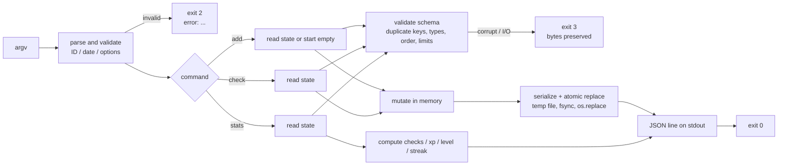
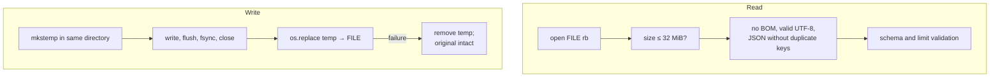

# Offline Habit Tracker

A small, fully offline habit tracker for the command line. Habits live in a
plain JSON file; check-ins are recorded against explicit dates and are turned
into exact streaks, XP and levels on demand. There is no clock, no network, no
account and no sensor: every date that matters is an argument.

This repository implements **product v0.1.0** of the **spec v0.1.4** for idea
#68 (*Habit Tracker with Gamification*, CLI subset).

## Problem and scope

People who want to track a handful of habits should not need a service. This
tool keeps one local state file, appends check-ins atomically, and computes
statistics deterministically.

In scope:

- three commands — `add`, `check`, `stats` — over one JSON state file;
- exact streak, XP (`10 × checks`) and level (`floor(xp / 100)`) arithmetic;
- atomic, crash-safe persistence;
- native Windows and Ubuntu, Python 3.12, standard library only.

Out of scope (from the spec): reminders, notifications, a UI, sensors,
synchronisation, server mode, an injected clock, and the original idea's
React Native/Flutter application. Dates are never read from the system clock,
so out-of-order and future check-ins are legal.

## Requirements

- Python 3.12 (standard library only; no runtime dependencies).
- Linux/Ubuntu or native Windows. WSL, Bash and GNU coreutils are not required
  on Windows.

## Quickstart

Copy-paste this from the repository root (POSIX shell):

```console
$ ./app add habits.json walk
{"id":"walk","created":true}
$ ./app check habits.json walk --date 2026-01-01
{"id":"walk","date":"2026-01-01","added":true}
$ ./app check habits.json walk --date 2026-01-02
{"id":"walk","date":"2026-01-02","added":true}
$ ./app check habits.json walk --date 2026-01-03
{"id":"walk","date":"2026-01-03","added":true}
$ ./app stats habits.json --as-of 2026-01-03
{"habits":[{"id":"walk","checks":3,"xp":30,"level":0,"streak":3}]}
$ cat habits.json
{"habits":[{"id":"walk","dates":["2026-01-01","2026-01-02","2026-01-03"]}]}
```

On Windows, use `app.cmd` instead of `./app` (or `python app`):

```bat
app.cmd add habits.json walk
app.cmd stats habits.json --as-of 2026-01-03
```

`python app ...` works on both platforms without a shell-specific wrapper.
`./app` is the same program through its `#!/usr/bin/env python3` shebang.

## CLI

```text
usage: app add FILE ID
       app check FILE ID --date YYYY-MM-DD
       app stats FILE --as-of YYYY-MM-DD
       app --help
       app --version
```

| Command | Behaviour | Success output |
|---|---|---|
| `add FILE ID` | Creates `FILE` if absent; adds the habit with no dates. Existing habit is a no-op. | `{"id":ID,"created":true}` / `"created":false` |
| `check FILE ID --date DATE` | Requires the habit. Appends `DATE`; a repeat is a no-op. Out-of-order and future dates are accepted. | `{"id":ID,"date":DATE,"added":true}` / `"added":false` |
| `stats FILE --as-of DATE` | Read-only. Counts dates `<= DATE`; level = `floor(xp/100)`; streak counts consecutive days ending **exactly** on `DATE` (zero when `DATE` has no check). | `{"habits":[{"id":...,"checks":...,"xp":...,"level":...,"streak":...}]}` |

Global facts:

- `python app --version` prints exactly `offline-habit-tracker 0.1.0` followed
  by one LF; `--help` lists every command and option. Both work without a
  state file and exit 0 with empty stderr.
- Successful commands write one line of JSON to stdout and nothing to stderr.
- Errors write one `error: ...` line to stderr, nothing to stdout and no
  traceback.
- Exit codes: `0` success, `2` invalid input/usage, `3` I/O or corrupt state,
  `4` habit not found.
- `ID` matches ASCII `[a-z][a-z0-9-]{0,31}`. Dates are strict
  `YYYY-MM-DD` Gregorian dates from `0001-01-01` through `9999-12-31`;
  impossible dates such as `2026-02-30` are rejected.
- Options may be written `--date VALUE` or `--date=VALUE` and may appear
  before or after the positional arguments. Unknown options are usage errors.

## State file

```json
{"habits":[{"id":"walk","dates":["2026-01-01","2026-01-02"]}]}
```

- UTF-8 without BOM; one JSON object per file. Habit objects contain exactly
  `id` and `dates`; the top level contains exactly `habits`.
- Habits are unique and sorted by `id`. Dates are unique, sorted ascending and
  valid Gregorian dates.
- Any pre-existing file that violates this schema (including duplicate JSON
  keys, a BOM, a zero-byte file, non-object elements, booleans where strings
  are required, unsorted data, or a file over 32 MiB) is rejected with exit
  `3` and is **never overwritten**.
- `add`/`check` validate everything before writing. Writes go to a temporary
  file in the same directory, are flushed, `fsync`ed, closed and then moved
  into place with `os.replace`. A failure leaves the original bytes intact and
  removes the temporary file when possible. A no-op command does not rewrite
  the file.
- `stats` never writes.

## Limits

- At most 100 habits, at most 10 000 dates per habit.
- State file at most 33 554 432 bytes (32 MiB).
- Consequently `checks <= 10000`, `xp <= 100000`, `level <= 1000`.
- A new habit/date that would exceed a limit exits `2` without changing the
  file. A pre-existing file already beyond a limit exits `3`.
- Limits are inclusive.

## Architecture





## Platform and entrypoints

| Platform | Entrypoint | Notes |
|---|---|---|
| Linux/Ubuntu | `./app` or `python app` | `app` is executable with a shebang |
| Windows | `app.cmd` or `python app` | `app.cmd` forwards all arguments and the exit code; no Bash needed |

No configuration, database or server is involved. Paths may contain spaces and
Unicode characters; all text I/O uses explicit UTF-8 and stdout uses LF.

## Tests and lint

One documented command runs the whole public suite (standard library only):

```console
$ PYTHONUTF8=1 python -m unittest discover -s tests -v
```

Static check (no third-party linter or formatter is used, so nothing needs
pinning beyond Python 3.12):

```console
$ python -m compileall -q app tests
```

The tests in `tests/test_cli.py` drive the program exclusively through
`subprocess` and `sys.executable`; no private module is imported. Each test
name carries the acceptance criterion it covers (`AC-1` … `AC-14`). The
write-failure fixture uses a read-only directory on POSIX and is skipped with a
documented reason on Windows and as root, where permission bits are not
enforced. All other fixtures are portable temporary directories.

CI runs the static check, the full suite and a launcher smoke test on
`ubuntu-latest` and `windows-latest` with Python 3.12 and `PYTHONUTF8=1`
(see `.github/workflows/ci.yml`).

## Decisions

- **No third-party dependencies.** The CLI, persistence and tests use only the
  standard library, keeping the package trivially auditable and offline.
- **Strict reading, permissive insertion ordering.** Existing state that is
  unsorted or otherwise outside the schema is a corrupt file (exit `3`); new
  dates are sorted on write while accepting any order on input.
- **Validation before observation.** Arguments are validated before the state
  file is read, so an invalid date combined with an unknown habit exits `2`,
  while a valid date with an unknown habit exits `4`.
- **Explicit dates only.** No wall clock is consulted; streaks are anchored to
  the `--as-of` day, so a missing check on that exact day means streak `0`.
- **Atomic replacement, not in-place truncation.** A reader never observes a
  partially written file.

## How this was built

- **Spec:** v0.1.4 of issue #68's spec (product v0.1.0).
- **Implementation:** written by an AI coding agent running in the Claude Code
  harness. Observed model identifier reported by the execution environment:
  `deepseek-flash`. The implementation and its public tests were produced in
  the same run.
- **Public tests:** written by that same agent from the spec. They are not an
  independent second implementation and no model-family independence is
  claimed. The maintainer's independent black-box tests, authored by a
  different agent outside this clone, are a separate review stage and are not
  represented here.
- **Human participation:** the maintainer defined the spec and owns review,
  tagging and release. No human edits to the implementation were observed
  during this run; corrections made during review are the maintainer's to
  record.
- **Results:** local Linux execution of the public suite is green. Windows CI
  results are only claimed once the workflow has actually run; they are not
  asserted in advance.

Spec, tests and implementation are distinct stages; nothing here predicts
review or hidden-test verdicts.

## License

MIT, Copyright (c) 2026 Forgeline Labs. See [LICENSE](LICENSE).
